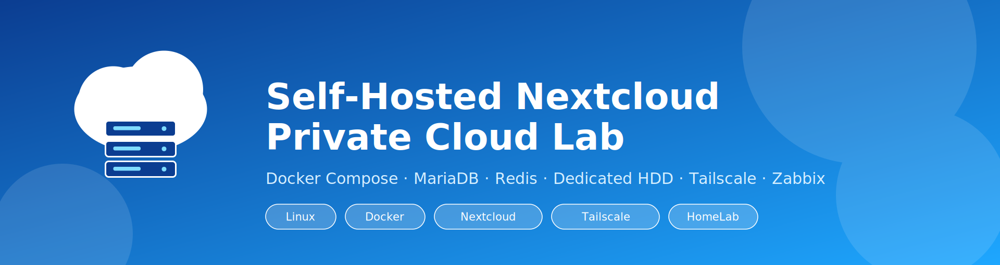
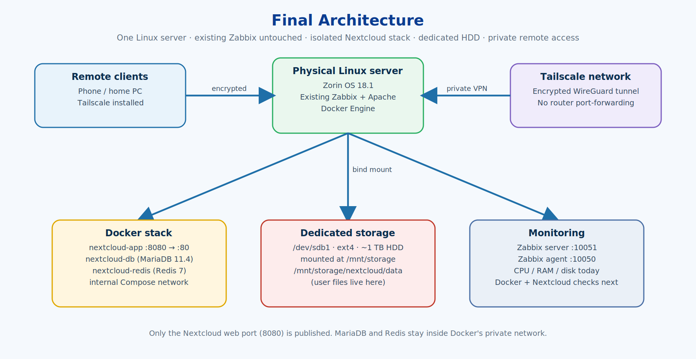
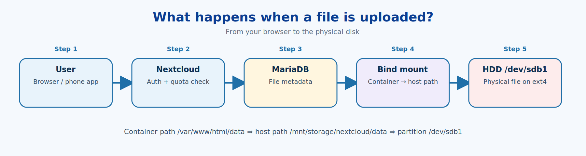
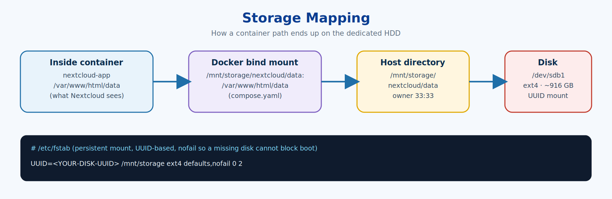
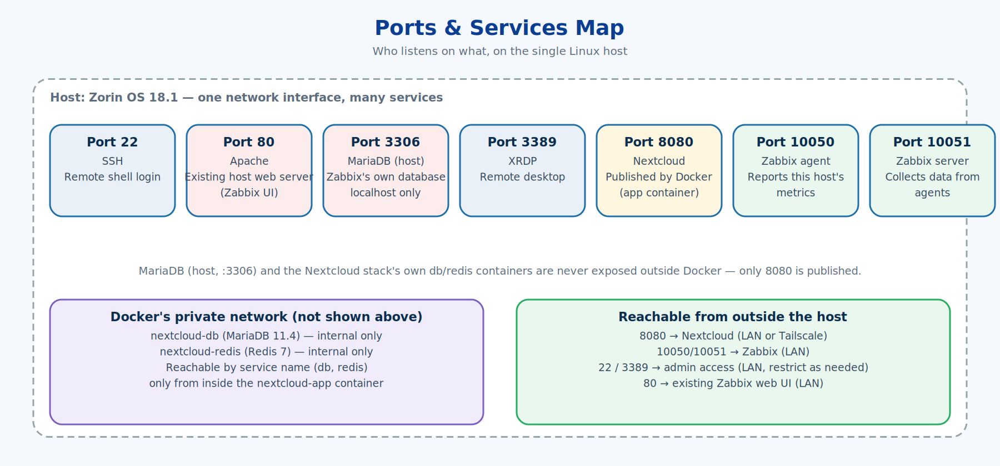
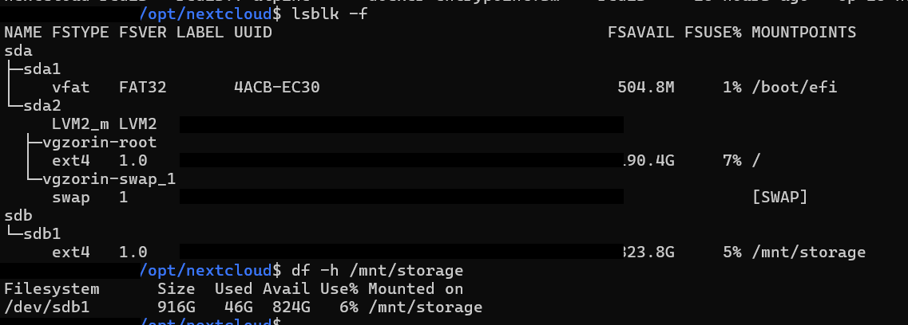
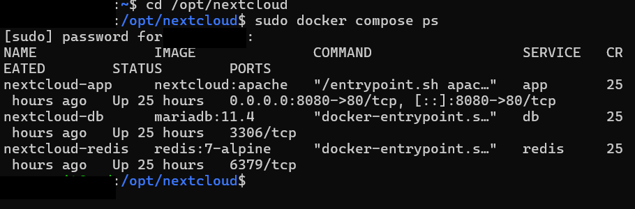
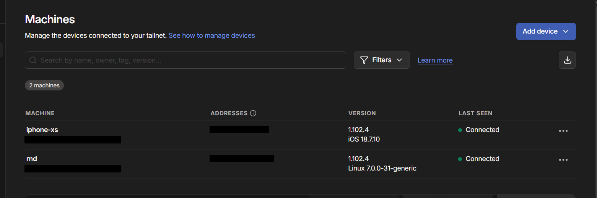
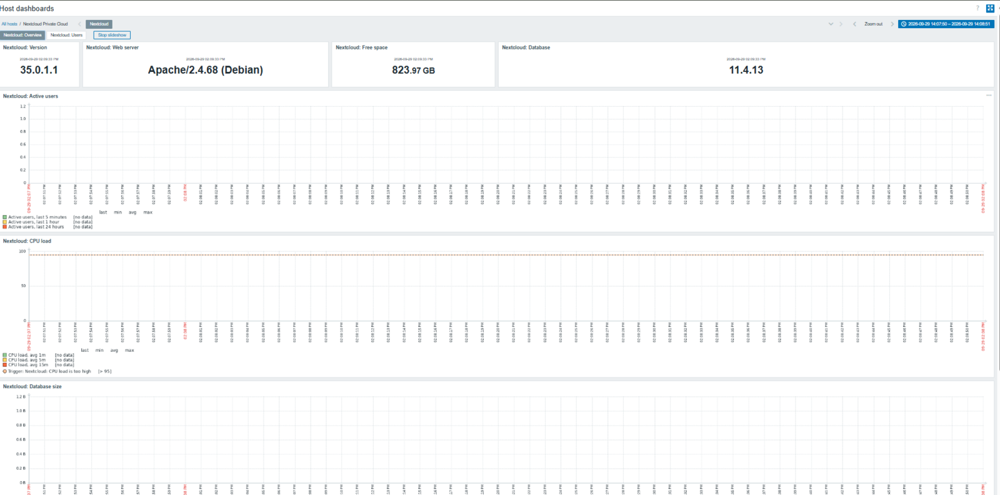
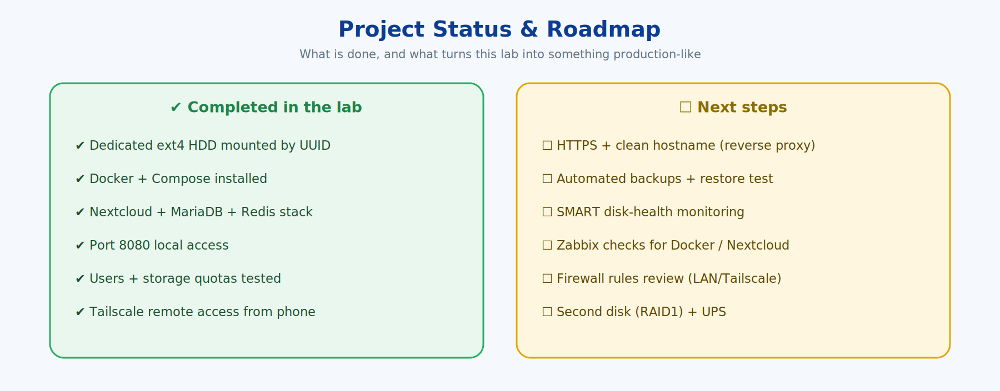

<p align="center">
  
</p>

<p align="center">
  
  
  
  
  
  
  
  
  
</p>

<h1 align="center">Self-Hosted Nextcloud Private Cloud</h1>

<p align="center">
  A step-by-step, command-by-command build of a private cloud on a real Linux server —<br>
  with dedicated disk storage, containers, user quotas, and secure remote access.
</p>

---

## 📌 What is this project?

I turned an **existing physical Linux server** (already running a **Zabbix** monitoring system) into a **self-hosted private cloud** — without breaking Zabbix.

- **Nextcloud** gives users a web/mobile file cloud.
- **Docker Compose** keeps Nextcloud, its database and its cache isolated from the host.
- A **dedicated 1 TB ext4 HDD**, mounted by UUID, stores the user files.
- **User quotas** limit each account's storage.
- **Tailscale** lets my phone reach it from anywhere — with **no public exposure and no router port forwarding**.

> This repo is written as a **learning guide**: every command is explained — what it does, what each flag means, and why it was needed — so you can rebuild the lab yourself.

## ✨ Highlights

| | |
|---|---|
| 🧱 **Safe storage work** | Inspected the disk first, kept existing data, mounted by UUID with `nofail`, validated `fstab` before trusting it |
| 🐳 **Container isolation** | Nextcloud + MariaDB + Redis in Compose; no clash with host Apache/MariaDB/Zabbix |
| 💾 **Data on a dedicated HDD** | Docker bind mount → `/mnt/storage/nextcloud/data` on `/dev/sdb1` |
| 👥 **Multi-user quotas** | Logical limits (e.g. 1 GB) on top of physical capacity |
| 🔐 **Private remote access** | Tailscale tunnel, Nextcloud `trusted_domains` configured |
| 📊 **Watched by Zabbix** | Existing monitoring extended with a Nextcloud dashboard, not replaced |

## 🗺️ Architecture



| Component | Role |
|---|---|
| Zorin OS 18.1 | Linux host operating system |
| Zabbix | Existing monitoring platform (kept running) |
| Docker + Compose | Container runtime and multi-container definition |
| Nextcloud | Private cloud web application |
| MariaDB | Nextcloud database |
| Redis | Caching and file locking |
| `/dev/sdb1` (ext4) | Dedicated storage HDD |
| Tailscale | Encrypted private remote-access network |

## 🚀 Quick start

> Prerequisites: a Linux server with sudo, a spare disk (or a folder), and an internet connection. Read [`docs/01`](docs/01-server-baseline.md) and [`docs/02`](docs/02-storage-hdd.md) first — **do not format a disk you haven't inspected.**

```bash
# 1. Assess the server (read-only)
./scripts/preflight-check.sh

# 2. Prepare storage (see docs/02 for the safe, verified procedure)
sudo mkdir -p /mnt/storage/nextcloud/data
sudo chown -R 33:33 /mnt/storage/nextcloud/data

# 3. Install Docker + Compose (docs/03)
sudo apt update && sudo apt install -y docker.io docker-compose-v2
sudo systemctl enable --now docker

# 4. Deploy the stack (docs/04)
sudo mkdir -p /opt/nextcloud && sudo chown $USER:$USER /opt/nextcloud
cp compose.yaml .env.example /opt/nextcloud/ && cd /opt/nextcloud
cp .env.example .env && nano .env && chmod 600 .env   # set real passwords
sudo docker compose up -d
sudo docker compose ps

# 5. Open http://<SERVER_LAN_IP>:8080 and finish the installer
```

Then add users/quotas ([docs/05](docs/05-users-quotas.md)) and remote access ([docs/06](docs/06-remote-access-tailscale.md)).

## 📚 Learning path (read in order)

| # | Guide | You will learn |
|---|---|---|
| 01 | [Server baseline](docs/01-server-baseline.md) | `hostnamectl`, `free`, `df`, `lsblk`, `ip`, `ss` — assess before you change |
| 02 | [Storage & HDD mounting](docs/02-storage-hdd.md) | `blkid`, `mount`, `findmnt`, `/etc/fstab`, UUIDs, `nofail` |
| 03 | [Docker installation](docs/03-docker-install.md) | `apt`, `systemctl enable --now`, `hello-world` test, Compose |
| 04 | [Nextcloud stack](docs/04-nextcloud-stack.md) | `compose.yaml`, volumes vs bind mounts, `.env`, `chown 33:33` |
| 05 | [Users & quotas](docs/05-users-quotas.md) | Logical quota vs physical capacity |
| 06 | [Remote access with Tailscale](docs/06-remote-access-tailscale.md) | VPN access, `trusted_domains`, `occ` |
| 07 | [How it works](docs/07-how-it-works.md) | Upload flow, why Linux, why Docker |
| 08 | [Admin cheat sheet](docs/08-admin-cheatsheet.md) | Daily commands |
| 09 | [Security & production gaps](docs/09-security-and-production-gaps.md) | What's missing before this is production |
| 10 | [Roadmap](docs/10-roadmap.md) | HTTPS, backups, SMART, Zabbix checks |
| 11 | [Troubleshooting](docs/11-troubleshooting.md) | Common errors and fixes |
| 12 | [Zabbix monitoring](docs/12-zabbix-monitoring.md) | Version, free space, quotas and CPU load watched from the existing Zabbix server |

*Full index with quick descriptions: [`docs/README.md`](docs/README.md).*

## 🔍 How a file reaches the disk





## 🔌 Ports & services



## 📸 Real screenshots

| | |
|---|---|
|  |  |
| `lsblk -f` + `df -h` showing the mounted HDD | All three containers `Up` |
|  |  |
| Phone and server on the same tailnet | Zabbix watching Nextcloud's version, free space and CPU |

*More in [`screenshots/`](screenshots) — accounts, quotas, mobile access and per-user Zabbix graphs.*

## 📁 Repository structure

```text
nextcloud-private-cloud/
├── README.md
├── compose.yaml            # Nextcloud + MariaDB + Redis stack
├── .env.example            # placeholders only - real .env is git-ignored
├── .gitignore
├── LICENSE
├── CHANGELOG.md
├── docs/                   # 11 step-by-step guides (01 → 11)
├── images/                 # architecture and flow diagrams (SVG + PNG)
├── scripts/
│   ├── preflight-check.sh  # read-only server assessment
│   ├── healthcheck.sh      # daily status check
│   └── backup.sh           # starter backup script (not restore-tested yet)
└── screenshots/            # your real screenshots + privacy checklist
```

## ✅ Status & honest limitations



This is a **working lab for learning and personal use**, not a production storage service. Zabbix now monitors the application (version, free space, quotas, CPU load — [docs/12](docs/12-zabbix-monitoring.md)), but HTTP is still the only protocol (inside the Tailscale tunnel), storage is a single disk with no redundancy, backups aren't automated yet, and there's no UPS. Details and fixes are in [docs/09](docs/09-security-and-production-gaps.md).

> **RAID is not a backup, and a backup isn't proven until you've restored from it.**

## 🧠 Skills demonstrated

Linux administration · disk/filesystem management · persistent mounts (`fstab`, UUID) · Linux permissions · Docker & Docker Compose · container networking & volumes · MariaDB & Redis · Nextcloud administration · VPN/Tailscale networking · monitoring (Zabbix) · troubleshooting · technical documentation.

## 🛡️ Security notes for anyone forking this

- Never commit `.env`, passwords, tokens or real IPs/tailnet names.
- Blur personal data in screenshots ([checklist](screenshots/README.md)).
- Don't expose port 8080 to the public internet as-is; add HTTPS + a hardened reverse proxy first.

## 🗺️ What's next

HTTPS + hostname · automated backups + restore test · SMART monitoring · per-container Docker health checks · firewall review · mirrored storage + UPS. See the [roadmap](docs/10-roadmap.md) and [changelog](CHANGELOG.md).

## 📄 License

MIT — see [`LICENSE`](LICENSE). Nextcloud, Docker, MariaDB, Redis, Tailscale and Zabbix are trademarks of their respective owners.

<p align="center"><i>If this guide helped you build your own, consider giving it a ⭐</i></p>
