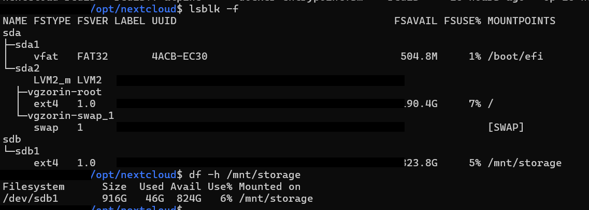

# 02 · Storage — HDD Discovery & Safe Mounting

[← 01 · Server Baseline](01-server-baseline.md) · [🏠 Home](../README.md) · [📚 All guides](README.md) · [03 · Docker Install →](03-docker-install.md)

---

Goal: keep **user files on the dedicated 1 TB HDD**, not on the operating-system disk, and make the mount survive reboots.

> ⚠️ **Never format a disk before you have looked inside it.** In this lab the drive already contained data (images and template data), so it was **not** formatted or repartitioned. A new `nextcloud/` folder was simply added beside the existing content.

## 2.1 Identify the disk and its filesystem

```bash
sudo lsblk -f
sudo blkid /dev/sdb1
sudo file -s /dev/sdb1
findmnt /dev/sdb1
```

| Command | What it does |
|---|---|
| `lsblk -f` | Block-device tree **with filesystem** type, label, UUID and mountpoint (`-f` = filesystems) |
| `blkid /dev/sdb1` | Prints the partition's UUID and filesystem type |
| `file -s /dev/sdb1` | Reads the device itself (`-s` = special files) and reports what is on it, e.g. an ext4 filesystem |
| `findmnt /dev/sdb1` | Shows where (if anywhere) the device is mounted. No output = not mounted |

**Result:** `/dev/sdb1` was already **ext4**, had a UUID, and was **not mounted**.

## 2.2 Inspect existing data before using the disk

```bash
sudo mkdir -p /mnt/hdd-check
sudo mount /dev/sdb1 /mnt/hdd-check
sudo ls -lah /mnt/hdd-check
df -h /mnt/hdd-check
sudo du -sh /mnt/hdd-check/* 2>/dev/null
```

| Command | What it does |
|---|---|
| `mkdir -p /mnt/hdd-check` | Creates a temporary mount point. `-p` = create parents, no error if it exists |
| `mount /dev/sdb1 /mnt/hdd-check` | Attaches the partition to that folder (temporary, gone after reboot) |
| `ls -lah` | Long listing (`-l`), including hidden (`-a`), human-readable sizes (`-h`) |
| `df -h /mnt/hdd-check` | Capacity and free space of that filesystem |
| `du -sh /mnt/hdd-check/*` | Size of each top-level item. `-s` = summary per item, `-h` = human sizes |
| `2>/dev/null` | Throws away error messages (e.g. permission noise) so the output stays readable |

## 2.3 Make the mount permanent

```bash
sudo umount /mnt/hdd-check
sudo mkdir -p /mnt/storage
sudo nano /etc/fstab
```

Added this line at the end of `/etc/fstab` (use **your** disk's UUID from `blkid`):

```fstab
UUID=<YOUR-DISK-UUID> /mnt/storage ext4 defaults,nofail 0 2
```

| Field | Value | Meaning |
|---|---|---|
| 1 · device | `UUID=…` | Identify the disk by UUID. Device names like `/dev/sdb1` can change when disks are added/removed; a UUID does not |
| 2 · mount point | `/mnt/storage` | Where the disk appears in the filesystem |
| 3 · type | `ext4` | Filesystem type |
| 4 · options | `defaults,nofail` | Standard options. **`nofail`** = boot continues even if the disk is missing (important for a non-system disk) |
| 5 · dump | `0` | Legacy backup flag, not used |
| 6 · pass | `2` | fsck order at boot: `1` = root filesystem, `2` = other disks |

The existing root, EFI and swap lines were left untouched.


### Validate **before** trusting it

A typo in `/etc/fstab` can stop a machine from booting cleanly, so test first:

```bash
sudo findmnt --verify --verbose
sudo systemctl daemon-reload
sudo mount -a
findmnt /mnt/storage
df -h /mnt/storage
sudo ls -lah /mnt/storage
```

| Command | What it does |
|---|---|
| `findmnt --verify --verbose` | Checks `/etc/fstab` for syntax and logic errors and explains each finding |
| `systemctl daemon-reload` | Makes systemd re-read fstab-generated mount units |
| `mount -a` | Mounts everything in fstab that isn't mounted yet. If this succeeds, the next reboot will too |
| `findmnt /mnt/storage` | Confirms the mount and shows its source and options |
| `df -h /mnt/storage` | Confirms size and free space |

✅ **Result:** the HDD mounted at `/mnt/storage` with about **916 GB** total and **865 GB** free.


*Real output from this lab: `/dev/sdb1` mounted at `/mnt/storage`, ~824 GB free at the time of the screenshot.*


---

[← 01 · Server Baseline](01-server-baseline.md) · [🏠 Home](../README.md) · [📚 All guides](README.md) · [03 · Docker Install →](03-docker-install.md)
