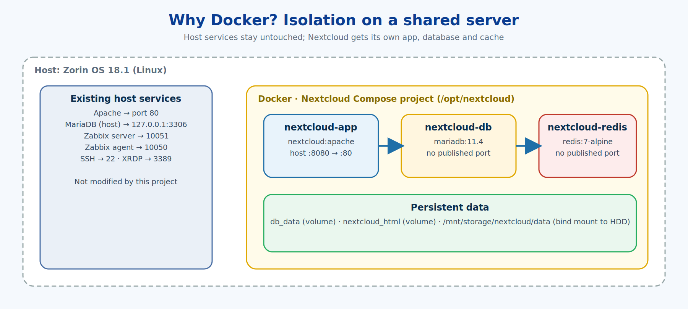
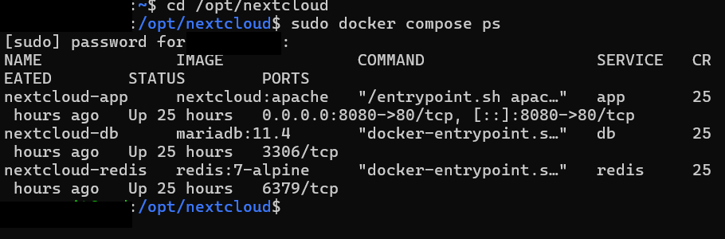
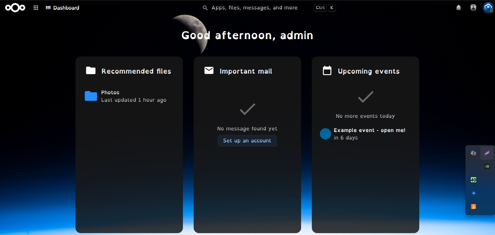

# 04 · Nextcloud Stack Design & Deployment

[← 03 · Docker Install](03-docker-install.md) · [🏠 Home](../README.md) · [📚 All guides](README.md) · [05 · Users & Quotas →](05-users-quotas.md)

---

Three containers, one web port exposed:

| Service | Container | Image | Purpose |
|---|---|---|---|
| `app` | `nextcloud-app` | `nextcloud:apache` | Nextcloud web application (host `:8080` → container `:80`) |
| `db` | `nextcloud-db` | `mariadb:11.4` | Database used **only** by Nextcloud |
| `redis` | `nextcloud-redis` | `redis:7-alpine` | Cache and file locking |



## 4.1 Create dedicated storage on the HDD

```bash
sudo mkdir -p /mnt/storage/nextcloud/data
sudo chown -R 33:33 /mnt/storage/nextcloud/data
sudo ls -ld /mnt/storage/nextcloud/data
```

| Command | What it does |
|---|---|
| `mkdir -p` | Creates the nested folder path in one go |
| `chown -R 33:33` | Changes owner and group to **UID/GID 33** recursively (`-R`). In the Nextcloud image, 33 is the `www-data` user, so the container is allowed to write here |
| `ls -ld` | Shows the folder's own permissions/owner (`-d` = the directory itself, not its contents) |

> If the owner is wrong, Nextcloud's installer fails with permission errors on the data directory. This is the most common mistake with bind-mounted data.

## 4.2 Create the project directory

```bash
sudo mkdir -p /opt/nextcloud
sudo chown $USER:$USER /opt/nextcloud
cd /opt/nextcloud
```

`/opt` is the conventional place for add-on application stacks. `chown $USER:$USER` hands the folder to your login user so you can edit files without `sudo`.

## 4.3 Secrets in a `.env` file

```bash
cp .env.example .env      # then edit the values
nano .env
chmod 600 /opt/nextcloud/.env
```

`.env.example` in this repo:

```dotenv
MYSQL_ROOT_PASSWORD=CHANGE_ME
MYSQL_PASSWORD=CHANGE_ME
MYSQL_DATABASE=nextcloud
MYSQL_USER=nextcloud
```

| Command | Meaning |
|---|---|
| `chmod 600 .env` | Owner can read/write, nobody else can. Passwords should not be world-readable |

> 🔐 Real passwords **never** go to GitHub. Commit `.env.example`, ignore `.env` (already in `.gitignore`).

## 4.4 The Compose file

See [`compose.yaml`](../compose.yaml). The important design choices:

- **Only `app` publishes a port** (`8080:80`). `db` and `redis` are reachable only inside Docker's private network, by service name (`db`, `redis`).
- **`--transaction-isolation=READ-COMMITTED`** is the setting Nextcloud recommends for MariaDB.
- **`restart: unless-stopped`** brings the stack back after a reboot or crash.
- **Two kinds of storage:**
  - `nextcloud_html` — a Docker *named volume* (application code and `config.php`, on the system disk)
  - `/mnt/storage/nextcloud/data` — a *bind mount* to the HDD (the actual user files)

## 4.5 Validate, then start

```bash
cd /opt/nextcloud
sudo docker compose config --services
sudo docker compose config
sudo docker compose up -d
sudo docker compose ps
sudo ss -tulpn | grep 8080
sudo docker compose logs app --tail=30
```

| Command | What it does |
|---|---|
| `compose config --services` | Lists services Compose understood. Expected: `db`, `redis`, `app` |
| `compose config` | Prints the fully resolved file (variables from `.env` substituted). Catches YAML mistakes before anything runs |
| `compose up -d` | Creates networks/volumes and starts containers. `-d` = detached (background) |
| `compose ps` | Shows the stack's containers and state |
| `ss -tulpn \| grep 8080` | Confirms something is now listening on 8080 (`\|` pipes into `grep` to filter) |
| `compose logs app --tail=30` | Last 30 log lines of the `app` service |


*Real output: `nextcloud-app`, `nextcloud-db` and `nextcloud-redis` all `Up`, with 8080 published on the host.*

## 4.6 First login (local network)

Open `http://<SERVER_LAN_IP>:8080`. Nextcloud shows its setup page with the database details pre-filled from the container environment:

| Field | Value |
|---|---|
| Data folder | `/var/www/html/data` (this is the path Docker maps to the HDD) |
| Database | MySQL/MariaDB |
| Database user / name | `nextcloud` / `nextcloud` |
| Database host | `db` (the Compose service name) |

Create the admin account and finish setup.


*The Nextcloud dashboard, logged in as admin, right after setup.*


---

[← 03 · Docker Install](03-docker-install.md) · [🏠 Home](../README.md) · [📚 All guides](README.md) · [05 · Users & Quotas →](05-users-quotas.md)
