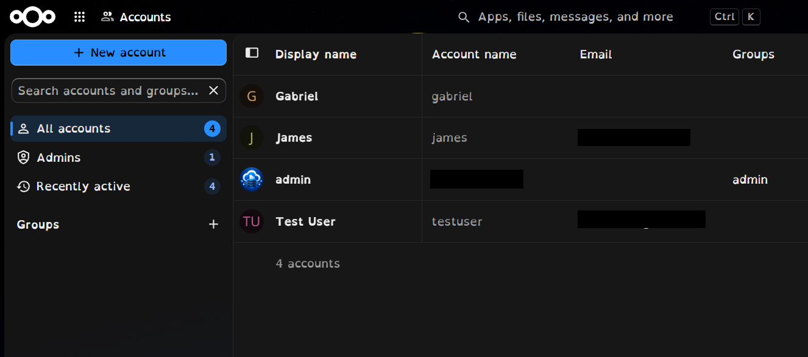
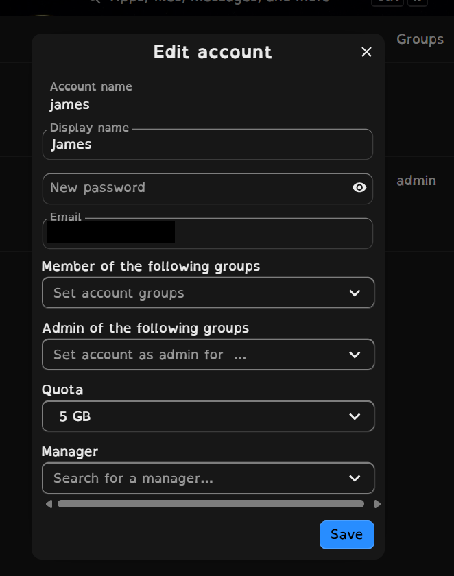
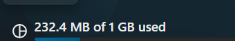

# 05 · Users & Storage Quotas

[← 04 · Nextcloud Stack](04-nextcloud-stack.md) · [🏠 Home](../README.md) · [📚 All guides](README.md) · [06 · Tailscale Access →](06-remote-access-tailscale.md)

---

The admin account was created first (during setup), then a normal **test user** with a **1 GB quota** to demonstrate customer-style storage limits.

## Create a user (web UI)

1. Log in as admin → click your avatar → **Accounts** (Users).
2. **New account** → fill in account name, password, email.
3. Set **Quota** (for example `1 GB`) → **Add new account**.

## Same thing from the command line

```bash
# list users
sudo docker exec -u www-data nextcloud-app php occ user:list
# set / change a quota
sudo docker exec -u www-data nextcloud-app php occ user:setting <username> files quota "1 GB"
```

| Part | Meaning |
|---|---|
| `docker exec` | Run a command inside an already running container |
| `-u www-data` | Run as the web-server user. Nextcloud's `occ` tool refuses to run as root, and running as the wrong user can break file ownership |
| `nextcloud-app` | Container name from `compose.yaml` |
| `php occ …` | `occ` is Nextcloud's admin command-line tool |


*Real accounts in this lab, each with their own quota.*


*Setting a 5 GB quota on a test account through the web UI.*

## Physical capacity vs. logical quota

| Concept | Meaning |
|---|---|
| Physical HDD capacity | The real space available on `/dev/sdb1` (~916 GB) |
| User quota | The maximum a *Nextcloud account* may use |
| Example | A 1 GB quota can exist on a disk with hundreds of GB free |

**Business relevance:** one storage pool can back many plans (10 GB, 50 GB, 100 GB, 500 GB per user). Nextcloud enforces the *logical* limit; the HDD provides the *physical* capacity. Keep an eye on **total** quotas versus real free space (`df -h /mnt/storage`), because quotas can be over-allocated.


*From the user's own side: the Files app shows how much of the assigned quota is used.*


---

[← 04 · Nextcloud Stack](04-nextcloud-stack.md) · [🏠 Home](../README.md) · [📚 All guides](README.md) · [06 · Tailscale Access →](06-remote-access-tailscale.md)
