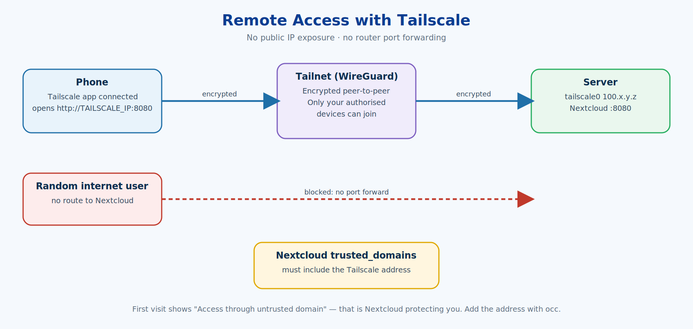
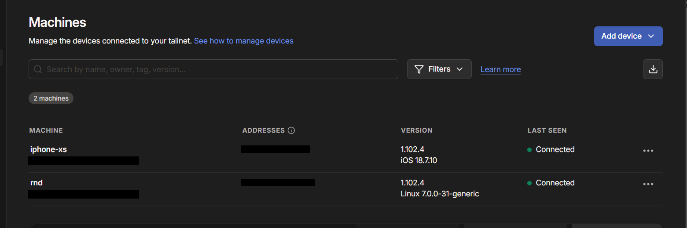
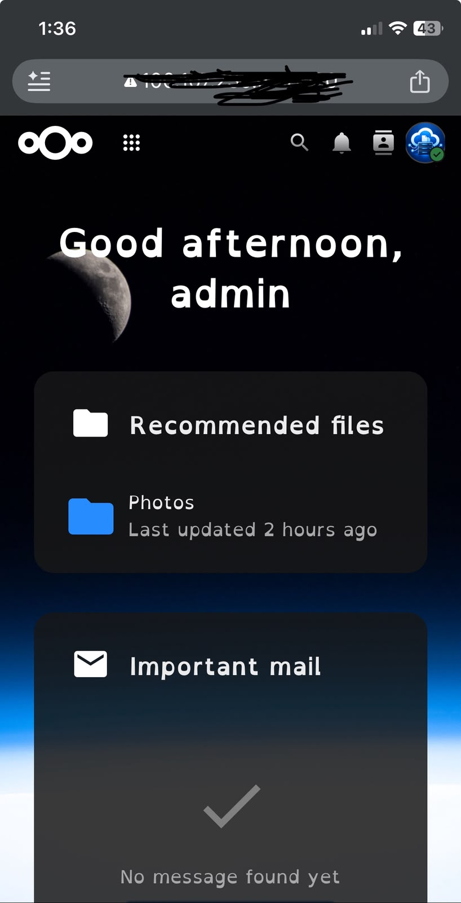

# 06 · Remote Access with Tailscale

[← 05 · Users & Quotas](05-users-quotas.md) · [🏠 Home](../README.md) · [📚 All guides](README.md) · [07 · How It Works →](07-how-it-works.md)

---

Goal: reach Nextcloud from a phone **outside** the home network **without** exposing it to the public internet and **without** router port forwarding.



Tailscale builds a private, encrypted network (a *tailnet*, based on WireGuard) between devices you log in with your own account. Only devices in your tailnet can reach the server's Tailscale address.

## 6.1 Install and connect the server

```bash
curl -fsSL https://tailscale.com/install.sh | sh
sudo tailscale up
tailscale status
tailscale ip -4
```

| Command | What it does |
|---|---|
| `curl -fsSL URL` | Download the install script. `-f` fail on HTTP errors, `-s` silent, `-S` still show errors, `-L` follow redirects |
| `\| sh` | Run the downloaded script. *Security note: only pipe scripts from vendors you trust; you can download and read it first* |
| `sudo tailscale up` | Connects this machine to your tailnet and prints a login URL |
| `tailscale status` | Lists devices in the tailnet and whether they are connected |
| `tailscale ip -4` | Shows this machine's Tailscale IPv4 address (a `100.x.y.z` address) |


*The phone (`iphone-xs`) and the server (`rnd`) both connected to the same tailnet. Addresses and account email blurred.*

## 6.2 Connect the phone

Install the Tailscale app on the phone, sign in with the **same account**, then open:

```
http://<TAILSCALE_IP>:8080
```

## 6.3 Fix "Access through untrusted domain"

The first visit shows Nextcloud's **"Access through untrusted domain"** page. That is Nextcloud doing its job: it only answers to hostnames/IPs listed in `trusted_domains`. The network path worked; Nextcloud simply hadn't been told about the new address.

```bash
# 1. see the current list
sudo docker exec -u www-data nextcloud-app \
  php occ config:system:get trusted_domains

# 2. add the Tailscale address at the next free index
sudo docker exec -u www-data nextcloud-app \
  php occ config:system:set trusted_domains 2 \
  --value="<TAILSCALE_IP>:8080"

# 3. confirm
sudo docker exec -u www-data nextcloud-app \
  php occ config:system:get trusted_domains
```

| Part | Meaning |
|---|---|
| `config:system:get trusted_domains` | Prints the list, one entry per index (0, 1, …) |
| `config:system:set trusted_domains 2` | Writes to **index 2**. Indexes 0 and 1 were already in use (localhost and the LAN address from setup), so 2 was the next free slot. Reusing an index would overwrite that entry |
| `--value="…"` | The hostname/IP (and port) to trust |
| `\` at line end | Continues the command on the next line |

✅ **Result:** the phone opens and uses the same Nextcloud instance through the encrypted tunnel.



*Nextcloud, logged in and working, on a phone connected only through Tailscale — no public exposure.*

> ✋ Do not paste real Tailscale IPs, tailnet names or account e-mails in public screenshots. See the privacy checklist in [`screenshots/README.md`](../screenshots/README.md).


---

[← 05 · Users & Quotas](05-users-quotas.md) · [🏠 Home](../README.md) · [📚 All guides](README.md) · [07 · How It Works →](07-how-it-works.md)
