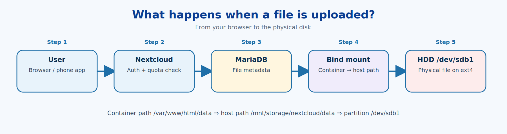
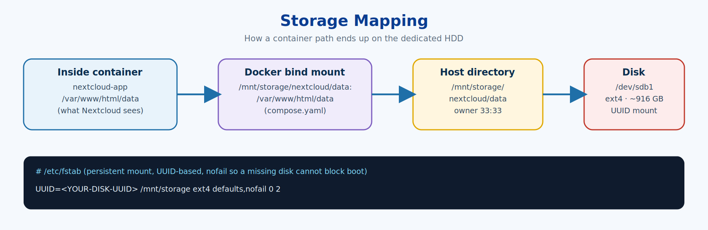
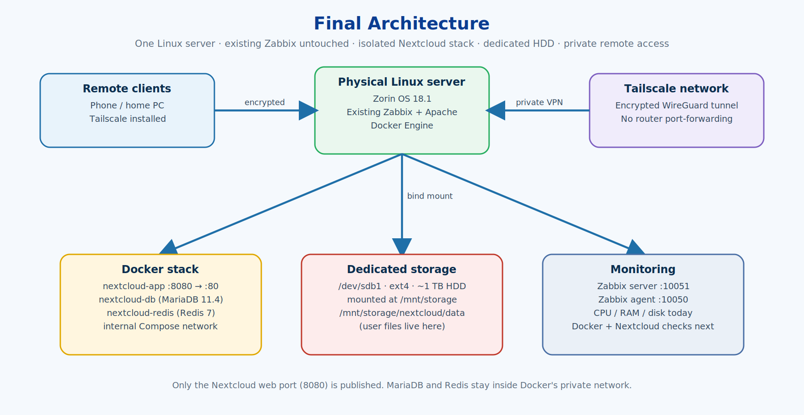

# 07 · How the System Works

[← 06 · Tailscale Access](06-remote-access-tailscale.md) · [🏠 Home](../README.md) · [📚 All guides](README.md) · [08 · Admin Cheat Sheet →](08-admin-cheatsheet.md)

---

## The life of an uploaded file



1. The **user** uploads from a browser or the mobile app.
2. **Nextcloud** authenticates the account and checks permissions and **quota**.
3. File **metadata** (name, owner, path, sharing info) is stored in **MariaDB**.
4. The file itself is written to `/var/www/html/data` **inside the container**.
5. Docker's **bind mount** maps that path to `/mnt/storage/nextcloud/data` on the host.
6. That host folder lives on the dedicated HDD, **`/dev/sdb1`**.

```text
User upload
  -> Nextcloud :8080
  -> authentication + quota check
  -> metadata -> MariaDB
  -> file -> /var/www/html/data
  -> Docker bind mount
  -> /mnt/storage/nextcloud/data
  -> /dev/sdb1 physical HDD
```



## Why Linux?

- Direct control of disks, partitions, filesystems, mounts, users and permissions.
- Excellent server tooling: networking, services, containers, monitoring.
- The standard platform for infrastructure, cloud and DevOps work.
- Everything is repeatable with commands instead of clicking around a NAS appliance GUI.

| Linux command | Skill demonstrated |
|---|---|
| `lsblk` / `blkid` | Block-device and filesystem discovery |
| `mount` / `findmnt` / `fstab` | Persistent storage management |
| `df` / `du` | Capacity and usage analysis |
| `ss` | Network socket and port troubleshooting |
| `systemctl` | Service management |
| `chmod` / `chown` | Linux permissions |
| `docker` | Container lifecycle |
| `docker compose` | Multi-service orchestration |

## Why Docker?

The host already had Apache, MariaDB and Zabbix. Docker gave Nextcloud its **own** app, database, cache and network so nothing could clash with them.

```text
Host Linux
├── Existing Zabbix + Apache + MariaDB   (untouched)
└── Docker
    ├── nextcloud-app
    ├── nextcloud-db
    └── nextcloud-redis
```




---

[← 06 · Tailscale Access](06-remote-access-tailscale.md) · [🏠 Home](../README.md) · [📚 All guides](README.md) · [08 · Admin Cheat Sheet →](08-admin-cheatsheet.md)
