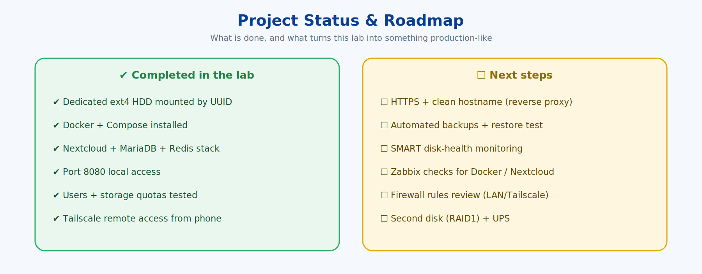

# 10 · Roadmap

[← 09 · Security & Gaps](09-security-and-production-gaps.md) · [🏠 Home](../README.md) · [📚 All guides](README.md) · [11 · Troubleshooting →](11-troubleshooting.md)

---

1. **HTTPS and a clean hostname** for browser/app access (reverse proxy).
2. **Automated backups** of MariaDB, Nextcloud config and user data — starter in [`scripts/backup.sh`](../scripts/backup.sh).
3. **Documented restore test.** A backup is not proven until a restore works.
4. ~~**Zabbix monitoring** for Nextcloud (version, web server, free space, database, active users, CPU load, per-user quotas)~~ — ✅ **done**, see [docs/12](12-zabbix-monitoring.md). Still open: per-container Docker health checks and an HTTP check on port 8080 from Zabbix itself.
5. **SMART monitoring** for `/dev/sdb` with alerts on health changes.
6. **Firewall rules** and a review of what must be reachable from LAN vs. Tailscale.
7. **Second disk** for mirrored storage if the project grows beyond a lab.
8. **UPS** for the server if it will store important data.
9. **Keep a change log** as backup, HTTPS, monitoring and hardening are added ([`CHANGELOG.md`](../CHANGELOG.md)).

Contributions to the checklist happen through commits: tick items off here and record them in the changelog.

---

[← 09 · Security & Gaps](09-security-and-production-gaps.md) · [🏠 Home](../README.md) · [📚 All guides](README.md) · [11 · Troubleshooting →](11-troubleshooting.md)
