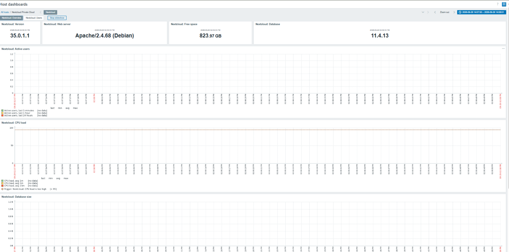
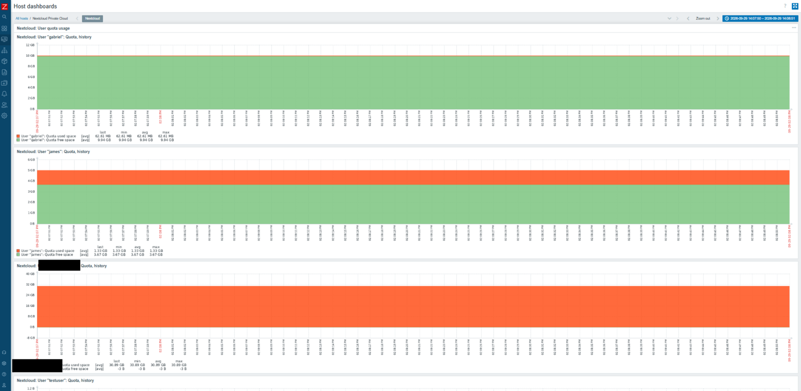

# 12 · Zabbix Monitoring for Nextcloud

[← 11 · Troubleshooting](11-troubleshooting.md) · [🏠 Home](../README.md) · [📚 All guides](README.md)

---

The lab's roadmap originally listed *"Add Zabbix monitoring for Docker/Nextcloud"* as a future step ([docs/10](10-roadmap.md)). It's now done: the existing Zabbix server was pointed at the Nextcloud host and given two dashboards.

## What's monitored

A host called **"Nextcloud Private Cloud"** was added in Zabbix with an **Overview** dashboard and a **Users** (per-account quota) dashboard.

**Overview dashboard**

| Widget | Shows |
|---|---|
| Nextcloud: Version | Installed Nextcloud version (e.g. `35.0.1.1`) |
| Nextcloud: Web server | Web server + OS string (e.g. `Apache/2.4.68 (Debian)`) |
| Nextcloud: Free space | Free space on the data storage (matches `df -h /mnt/storage`) |
| Nextcloud: Database | Database engine + version |
| Nextcloud: Active users | Active users in the last 5 min / 1 hour / 24 hours |
| Nextcloud: CPU load | Host CPU load, with a trigger above 95% |
| Nextcloud: Database size | Growth of the Nextcloud database over time |



**Users dashboard**

One quota-history graph per account (`gabriel`, `james`, the admin account, `testuser`), each showing **used vs. free** space against that user's quota — the same quotas configured in [docs/05](05-users-quotas.md), now visible as a trend instead of a single number in the web UI.



## Why this matters

Before this, quota and capacity information only existed inside the Nextcloud web UI, checked by hand. Now:

- A sudden jump in a user's quota usage is visible on a graph instead of discovered when they complain about "disk full".
- Free space on `/mnt/storage` is tracked over time, so it's possible to see a trend and plan for more storage *before* running out.
- The same Zabbix instance that already watched the host now watches the application running on it — no separate monitoring stack needed.

## How data gets from Nextcloud into Zabbix

```text
Nextcloud (occ / serverinfo API)
  -> Zabbix agent (already installed on this host, port 10050)
  -> Zabbix server (already running on this host, port 10051)
  -> Dashboards shown above
```

This reuses the **same agent and server** that were already monitoring the host before this project started (see [docs/01](01-server-baseline.md)) — Nextcloud items were simply added to the existing host/template, which is exactly the "coexistence with Zabbix" goal this whole project was built around.

## Remaining monitoring gaps

The dashboards above cover the *application*. Still open, per [docs/09](09-security-and-production-gaps.md) and [docs/10](10-roadmap.md):

- Per-container Docker health checks (is `nextcloud-app`/`db`/`redis` actually running, not just "is the host up")
- HTTP availability check on port 8080 from Zabbix itself
- SMART health monitoring for `/dev/sdb`


---

[← 11 · Troubleshooting](11-troubleshooting.md) · [🏠 Home](../README.md) · [📚 All guides](README.md)
